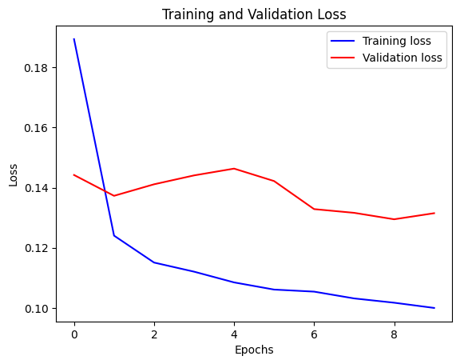
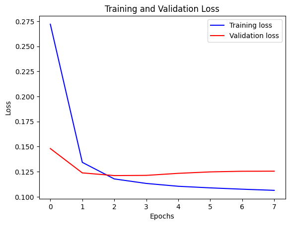
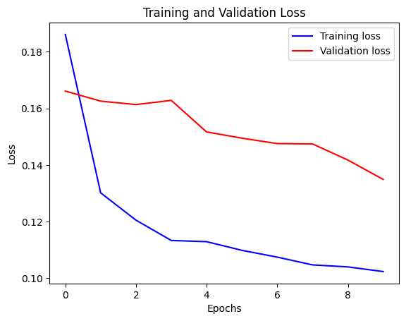
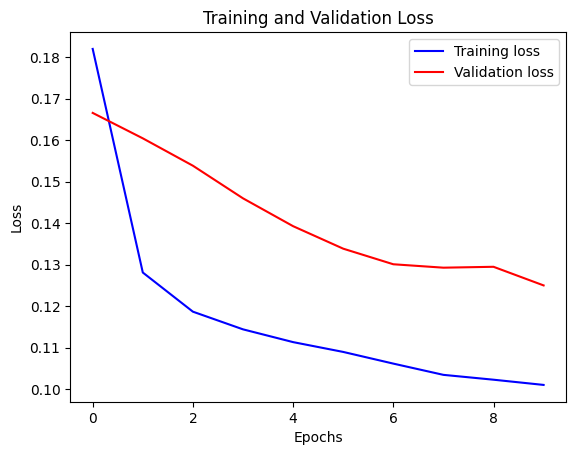

# CMPE 401 Instructor-defined Project 2
# Understand, Organize Time Series Modelling Benchmarks for Classification and Forecasting

Group members: Fortune Olawale, Trevor Wu.

# 1. Project Overview
This project explores two time-series modelling tasks using official Keras examples:
1. Time-series classification: A Transformer model trained on FordA dataset.
2. Time-series forecasting: A LSTM (Long Short-Term Memory) model trained on Jena Climate dataset.

Time-series data is commonly used in engineering and real-world applications, including weather monitoring, industrial sensing, health monitoring, traffic analysis, and activity recognition.

The project focuses on understanding how these two neural network architectures work, reproducing the provided implementations, and investigating how modifications to model configurations and architecture affect training behaviour and predictive performance.

**The LSTM forecasting model was selected for the improvement experiments. Details below.**

# 2. Objectives
The main objectives of this project are to:
1. Understand the differences between time-series classification and time-series forecasting.
2. Understand the differences between a Transformer-based model and an LSTM-based model.
3. Reproduce and run the provided Keras examples.
4. Understand the dataset, model input and output, training processes, and evaluation metrics.
5. Investigate how changes to training configurations affect model peroformance.
6. Modify an existing model architecture and evaluate the effects of the modification.
7. Organize the notebooks, results, and observations into a documented GitHub repository.

# 3. Datasets
Two datasets are used in this project.

## 3.1 FordA
FordA is used for the Transformer-based time-series classification task.

The dataset contains time-series measurements represented as sequences of 500 observations with one feature per time step. The objectives is to classify each sequence into one of two classes.

## 3.2 Jena Climate
The Jena Climate dataset is used for the LSTM-based forecasting task.

The dataset was recorded at the weather station of the Max Planck Institute for Biogeochemistry in Jena, Germany, between January 2009 and December 2016. It contains weather measurements such as temperature, atomspheric pressure, humidity, and wind speed.

The original dataset contains 14 features recorded every 10 minutes. For this project, seven selected features are used, and the data is sampled hourly.

The LSTM has:
- Input sequence: 120 time steps, with 7 features per time step.
- Historical window: Approximately 5 days of weather observations.
- Prediction target: Temperature 12 hours after the input window.

The dataset is normalized before training to help the model earn from features with different numerical ranges.

# 4. Model Architectures
## 4.1 Transformer
The Transformer uses self-attention mechanisms to identify relationships between different positions in a sequence. Unlike recurrent networks (such as LSTM), it can process sequence positions in parallel during training.

The provded implementation uses Transformer encoder blocks containing multi-head attention and feed-forward layers, followed by global average pooling and dense classification layers.

The model is trained to classify FordA sequences into two classes using sparse categorical cross-entropy as its loss function.

## 4.2 LSTM
The LSTM is a type of recurrent neural network designed to learn temporal relationships in sequential data. It uses gates to control which information is retained, updated, or discarded over time.

The original Keras implementation consists of:
1. Input: 120 time steps, each containing 7 weather features.
2. LSTM layer: 32 units that process the input sequence and extract temporal information.
3. Dense layer: One output neuron that produces the predicted temperature.

The model uses the Adam optimizeer with a learning rate of 0.001 and mean squared error (MSE) as its loss function.

## 4.3 Transformer vs. LSTM
| Feature | Transformer | LSTM |
| ------- | ----------- | ---- |
|Data processing|Can process sequence positions in parallel using self-attention.|Processes sequences recurrently, one time step at a time.|
|Key mechanism|Self-attention using queries, keys, and values.|Input, forget, and output gates.|
|Training speed|Parallel processing can improve GPU utilization.|Sequential dependencies can limit parallel processing.|
|Long-range context|Directly relates distant positions through attention.|Retains information through hidden and cell states, although very long dependencies can be challenging.|
|Computational characteristics|Self-attention has quadratic scaling with sequence length.|Recurrent computation scales approximately linearly with sequence length, but is sequential.|

Neither architecture is universally faster or more efficient. Their performance depends on the sequence length, model size, hardware, and implementation.

# 5. Baseline Results
The Colab notebooks were used to establish baseline results before performing any modifications.
The baseline CSV file is available at **results/baseline_transformer_and_lstm.csv**.

| Measurement | Transformer | LSTM |
| ----------- | ----------- | ---- |
|Dataset|FordA|Jena Climate|
|Maximum epochs|150|10|
|Actual epochs competed|11|10|
|Batch size|64|256|
|Learning rate|0.0001|0.001|
|Recorded training loss|0.6928|0.1058|
|Recorded validation loss|0.6927|0.1295|
|Test performance (accuracy)|0.5159|N/A|
|Sparse categorical accuracy (SCA)|0.5122|N/A|
|Validation SCA|0.5146|N/A|
|Validation MAE|N/A|0.2853|
|Validation MSE|N/A|0.13149|
|Training time|9 minutes|10 minutes|

**Transformer baseline observation:**

The Transformer training stopped early after 11 epochs because the validation loss did not improve. Its test accuracy was approximately 51.59%, with a loss close to 0.693.

During investigation, an inconsistency was identified in the `GlobalAveragePooling1D` layer. The provided source code specifies `data_format="channels_last"`, producing an output shape of of `(None, 1)` for an input shape of `(None, 500, 1)`. However, the model summary published on the official Keras example shows an output shape of `(None, 500)`.

This discrepancy was documented and reported to the instructor (via email). The instructor comfirmed that retaining the original implementation and its results as the baseline was acceptable. The results are therefore retained without making architectural corrections.

**LSTM baseline observation:**

The training loss generally decreased throughout the 10 epochs, while the validation loss fluctuated and eventually increased after reaching a lower value earlier in training.

This suggests that the model may have started overfitting, as it continued improving its fit to the training data without achieving corresponding improvements on the validation data.

However, the baseline was only run once. Therefore, additional runs would be necessary to determine how consistently this behaviour occurs.

# 6. Improvement Experiments
The LSTM forecasting model was selected for the improvement task. Three experiments were performed, with one major variable changed at a time while keeping the remaining configuration unchanged.

## 6.1 Experiment 1: Increasing Batch Size
**Modification:**
- Original batch size: 256
- Modified batch size: 512
- Learning rate: 0.001
- Architecture: One LSTM layer with 32 units.

**Observations:**

The model stopped early after 8 out of 10 maximum epochs. The training log shows that the validation loss reached its lowest value of approximately 0.1211 at epoch 3. It then increased over the following epochs, while the training loss continued to decrease.

The early stopping callbacked used a patience value of 5. Since the validation loss did not improve for 5 consecutive epochs after epoch 3, training stopped after epoch 8. (Even though early stopping is outside of the scope of this project as mentioned by the instructor, I have decided to look into it)

The training and validation curves also appeared smoother compared with the baseline. This may be explained by the larger batch size. Increasing the batch size reduces the number of batches processed per epoch, meaning fewer weight updates occur during training. Each update is also calculated using more training samples.

The final recorded validation loss was 0.1255, even though the best validation loss was 0.1211 at epoch 3.

Training time decreased from approximately 10 minutes to 6 minutes. This suggests that the larger batch size reduced the overall training time in this particular experiment, although the experiment also completed fewer epochs.

## 6.2 Experiment 2: Increasing Learning Rate
**Modification:**
- Batch size: 256
- Original learning rate: 0.001
- Modified learning rate: 0.002
- Architecture: One LSTM layer with 32 units.

**Observations:**

The training loss decreased to 0.1023, compared with 0.1058 in the baseline.

However, the final validation loss increased from the baseline of 0.1295 to 0.1349. This indicates that the lower training loss didn not translate into better validation performance.

The validation loss started relatively high at 0.1661 and generally decreased throughout training, reaching 0.1349 by epoch 10. There was a small increase at epoch 4, but the overall trend was downwards.

The higher learning rate did not cause obvious training instability in this experiment. However, it also did not improve the model's validation performance.

This demonstrates that increasing the learning rate does not necessarily improve model performance. Although the model achieved a lower training loss, its performance on validation data was worse than the baseline.

## 6.3 Experiment 3: Stacking Two LSTM Layers
**Modification:**
- Batch size: 256
- Learning rate: 0.001
- Original architecture: One LSTM layer with 32 units.
- Modified architecture: Two stacked LSTM layers, each with 32 units.

**Observations:**

The first LSTM layer was configured with `return-sequence=True` so that it would return its output at every time step. This sequence was then passed to the second LSTM layer, which produced the final output used by the Dense layer.

The modified model achieved a training loss of 0.1010 and a validation loss of 0.1250.

Compared with the baseline, both the training and validation losses decreased. The validation loss also generally decreased throughout the 10 epochs, with only a small increase at epoch 9.

The stacked model had 13,473 parameters, compared with 5,153 parameters in the original model. This is approximately 2.61 times as many parameters.

Training time also increased slightly from approximately 10 minutes to 11 minutes.

The results suggest that adding a second LSTM layer improved the model's validation performance in this particular run, although it required more parameters and slightly more training time.

# 7. Benchmark Comparison
The following table summarizes the results of the baseline and all three experiments.
|Configuration|Epochs|Training loss|Final validation loss|Best validation loss|Training time|
|---|---|---|---|---|---|
|Baseline|10|0.1058|0.1295|0.1276|10 min|
|Batch size 512|8|0.1064|0.1255|0.1211 (epoch 3)|6 min|
|Learning rate 0.002|10|0.1023|0.1349|0.1349|9 min|
|Two LSTM layers|10|0.1010|0.1250|0.1250|11 min|

## 7.1 Training and Validation Loss Graphs
**Baseline:**

**Experiment 1 (Batch Size 512):**

**Experiment 2 (Learning Rate 0.002):**

**Experiment 3 (Two Stacked LSTM Layers):**

# 8. Discussion
**Which model did you find easier to understand and why?**

Personally, I found the LSTM model easier to understand. At the time of completing this project (Nov 11, 2026), Transformers had not yet been covered in lectures, so I needed to refer to additional resources and research papers to understand how the architecture works. Additionally, the LSTM architecutre was more intuitive to follow because its recurrent structure and gating mechanisms provide a clear way of understanding how information is retained and updated over time.

**What improvement did you try, and what did you learn from it?**

The three experiments demonstrated that different modifications can affect training behaviour and validation performance in different ways.

Increasing the batch size reduced training time and produced smoother loss curves. However, the model stopped early because its validation loss began increasing after epoch 3. This best validation loss was 0.1211, although the final validation loss was 0.1255.

Increasing the learning rate reduced the training loss, but the validation loss was higher than the baseline. This demonstrated that a model fitting the training data more closely does not necessarily mean it performs better on unseen data.

Stacking two LSTM layers resulted in lower final training and validation losses than the baseline. However, this improvement came with a larger model and longer training time. It suggests that increasing model capacity can be beneficial, but the additional computational cost should also be considered.

Overall, these experiments showed the importance of evaluating both training and validation performance instead of relying on training loss alone.

**Which configuration performed best?**

There is no single winner across every measurement.
- Fastest training: Batch size 512, at approximately 6 minutes.
- Lowest recorded final validation loss: Two stacked LSTM layers, at approximately 0.1250.
- Lowest observed validation loss: Batch size 512, at approximately 0.1211 at epoch 3.
- Lowest training loss: Two stacked LSTM layers, at approximately 0.1010.

The batch-size experiment reached the lowest validation loss, but it also began overfitting and stopped early. The stacked LSTM produced a slightly higher validation loss at the end of training, but its validation curve generally continued improving and it completed all 10 epochs.

These results highlight the trade-offs between training efficiency, model complexity, and validation performance.

# 9. Limitations and Future Improvements
There are several limitations to this project:
1. Each configuration was trained only once. Repeating the experiments with different random seeds would help determine whether the observed differences are consistent.
2. The LSTM experiments use validation data for model evaluation. A separate test dataset would provide a more independent assessment of final predictive performance.
3. The experiments were limited to a small number of configurations and a maximum of 10 epochs.
4. Training times depend on the available Google Colab hardware and runtime conditions.
5. The transformer baseline has a documented discrepancy between the provided Colab implementation and its published model summary.

Future work could investigate different LSTM unit counts, dropout values, input sequence lengths, and prediction horizons. Additional experiments could also compare the models across repeated runs to improve the reliability of the results.

# 10. Conclusion
This project provided practical experience with time-series classification and forecasting using two different deep learning architectures.

The Transformer and LSTM examples demonstrated two different approaches to processing sequential data. The Transformer uses self-attention to identify relationships between sequence positions, while the LSTM uses recurrent connections and gating mechanisms to retain and update information over time.

The LSTM was selected for the improvement task. Three modifications were investigated: increasing batch size, increasing learning rate, and stacking two LSTM layers.

The results showed that increasing batch size reduced training time but led to early stopping, while increasing the learning rate reduced training loss without improving validation performance. Stacking two LSTM layers achieved lower final training and validation losses than the baseline, although it increased model complexity and training time.

Most importantly, the experiments demonstrated that improving a deep learning model is not simply a matter of increasing its size or changin its hyperparameters. Training behaviour, validation performance, computational cost, and model complexity must be considered when evaluating a modification.

Throught this project, I gained a better understanding of the overall deep learning workflow, including data preparation, model construction, training, evaluation, and experimentation.

# 11. Running the Notebooks
The notebooks can be opened and executed using Google Colab.
1. Open the desired notebook in Google Colab.
2. Selected a suitable runtime (GPU).
3. Connect to runtime and execute the notebook cells in order.
4. Review the model summary, training output, and loss graphs.

The original baseline notebooks are located in **notebooks/baseline**. The three modified LSTM experiment notebooks, including their recorded outputs, are located in **notebooks/modified with outout/**.

[Official Keras page for Transformer classification](https://keras.io/examples/timeseries/timeseries_classification_transformer/)

[Official Keras page for LSTM forecasting](https://keras.io/examples/timeseries/timeseries_weather_forecasting/)
